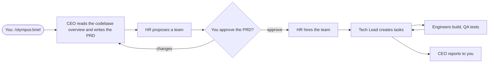
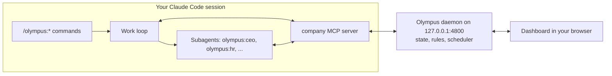

# Olympus: an AI tech company inside Claude Code

> Tell your CEO what to build. Approve the plan. Watch your AI company build it.

Olympus is a Claude Code plugin that runs a small software company made of Claude agents: a CEO, a
Head of HR, a Tech Lead, engineers, QA, DevOps and more (16 roles). You are the **Owner**. You give the
CEO a requirement, approve the plan, and the team builds it in your project while you watch on a live
dashboard. It runs on your Claude Code login: **no API key**.

**Hinglish mein:**
- Ye ek Claude Code plugin hai jo aapke computer par ek poori AI software company chalata hai. Aap Owner ho.
- Aap sirf CEO ko batate ho kya banana hai (`/olympus:brief ...`). CEO PRD likhta hai, aap approve karte ho, tabhi kaam aage badhta hai.
- Approve ke baad HR team hire karta hai, Tech Lead tasks banata hai, engineers code likhte hain, QA test karta hai.
- Jis project ki chat me aap Olympus chalate ho, team usi project me kaam karti hai. Pehle code ka overview leti hai, naya project nahi banati.
- Sab kuch ek live dashboard par dikhta hai: org chart, tasks, messages, activity.

---

## Contents

- [The problem](#the-problem)
- [How Olympus solves it](#how-olympus-solves-it)
- [Install in Claude Code](#install-in-claude-code)
- [Quick start](#quick-start)
- [Working in your existing project](#working-in-your-existing-project)
- [Commands](#commands)
- [The dashboard](#the-dashboard)
- [The team](#the-team)
- [Cost, limits and safety](#cost-limits-and-safety)
- [How it works inside](#how-it-works-inside)
- [Troubleshooting](#troubleshooting)
- [Development](#development)

---

## The problem

Building a real app with an AI assistant still needs one person to be the product manager,
architect, tech lead, QA and release manager at the same time. That person:

- splits the work into pieces and writes a prompt for each piece,
- keeps the context consistent across many chats,
- reviews everything, catches what was missed, and stitches it together.

One AI session can't hold a whole product in its head, and a bunch of separate sessions don't
coordinate themselves. On top of that, most "AI builds your app" tools start a brand-new project
every time, while most real work is a change to a codebase you already have.

## How Olympus solves it

Olympus gives you a company instead of a chat.

| What you need | What Olympus does |
| --- | --- |
| One place to describe what you want | You talk only to the **CEO**, like a founder talks to a hired CEO. |
| A clear plan before any code | The CEO writes a **PRD** (goals, user stories, acceptance criteria, scope). Nothing is hired and no task starts until **you approve it**. The rule lives in code, not just in a prompt. |
| The right people for the job | **HR** proposes a team sized to the work (and to your stack), with a level for each person, and hires them after you approve. |
| Work split without collisions | The **Tech Lead** breaks the PRD into small tasks, one owner each, with acceptance criteria and the files each person owns, and runs the board until everything is done. |
| Specialists, not one generalist | 16 role agents, each with its own handbook, charter, model and tools: frontend, Node or Python backend, database, QA, DevOps, security, designer, writer, and more. |
| Changes to code you already have | Olympus works in **the project you run it from**. It scans the codebase first and gives every employee an overview, so they change your code instead of starting over. |
| Seeing what is going on | A **live dashboard** with an org chart, task board, PRD review, messages, activity and charts. |
| Staying in control | You approve the PRD, hire and fire anyone (even the CEO), message the CEO, and set limits on how much work runs. |

The flow of one piece of work:



---

## Install in Claude Code

### What you need

- **Claude Code**, signed in (the CLI or the Claude desktop app's Code tab). Olympus uses its login.
- **Node.js 22 or newer** on your PATH. Check with `node --version`. The plugin's server and dashboard run on Node.
- macOS or Linux. Windows is not tested yet.

### Install

Run these two commands in a terminal. The first adds this GitHub repo as a plugin marketplace, the
second installs the plugin from it.

```bash
claude plugin marketplace add hariharbajpai/olympus
```

```bash
claude plugin install olympus@olympus
```

You can do the same from inside an interactive `claude` session with
`/plugin marketplace add hariharbajpai/olympus` and then `/plugin install olympus@olympus`.

The plugin ships ready to run (`plugin/dist` holds the built server, daemon and dashboard), so there
is no build step.

### Check it worked

```bash
claude plugin list
```

You should see `olympus@olympus` with its version and `enabled`. Then **start a new session** (in the
terminal or the desktop app) and type `/olympus`: the Olympus commands show up.

### Update to a newer version

```bash
claude plugin marketplace update olympus
```

```bash
claude plugin update olympus@olympus
```

Then start a new Claude Code session. If the dashboard was running, restart it with `/olympus:stop`
and `/olympus:start` so the new version runs.

### Uninstall

```bash
claude plugin uninstall olympus@olympus
```

Your company's saved state stays in `~/Olympus/` until you delete that folder.

---

## Quick start

1. **Open your project.** Start Claude Code in the project folder (`cd my-project && claude`), or open a
   new session on that folder in the desktop app.
2. **Start the company.** Run `/olympus:start`. It starts Olympus in the background and opens the
   dashboard in your browser. You begin with two people: Aarav Kapoor (CEO) and Meera Iyer (Head of HR).
3. **Brief the CEO.**
   ```text
   /olympus:brief Add discount codes to the cart: a percent or a fixed amount, one per order, with an expiry date
   ```
   The session runs the team as subagents. The CEO reads the codebase overview, asks HR for a team,
   and writes PRD v1.
4. **Review the PRD.** Read it with `/olympus:prd` or on the dashboard's Project page. Then:
   - `/olympus:approve` to go ahead, or
   - `/olympus:changes make the expiry date optional` to send it back.
5. **Watch it get built.** After approval, HR hires the team, the Tech Lead creates tasks, and the
   engineers build and test. Follow along on the dashboard, or ask `/olympus:status`.
6. **Review and commit.** In an existing project, the team leaves git to you: look at the changes
   (`git diff`) and commit what you want.

Work only moves while an `/olympus` command is running the work loop in your session. If you act on
the dashboard (approve, message the CEO), run `/olympus:run` so the team picks it up.

---

## Working in your existing project

Olympus works in the folder of the Claude Code session you brief it from. Open a chat in a project you
already have, run `/olympus:brief <what to change>`, and the team works **in that project**. No new
project is created.

Before anyone plans, Olympus scans the folder (read-only) and builds an overview:

- the main languages and the top-level layout (dependency and build folders are skipped),
- build and dependency files such as `package.json`, `pyproject.toml`, `go.mod`, `Cargo.toml`, `Dockerfile`,
- the git branch,
- the start of your `README`, and your `CLAUDE.md` or `AGENTS.md`, which the team follows.

Every employee gets this overview, and each role uses it:

- The **CEO** writes the PRD as a change to your product ("What exists today", "What stays the same",
  which parts of the code it touches).
- **HR** staffs for your stack (a Python service gets a Python backend engineer).
- The **CTO, Tech Lead and Architect** keep your stack and structure, and name the existing files each task changes.
- **Engineers** read the code around their task, keep your conventions, don't reformat or delete code
  their task doesn't need, and **don't commit, switch branches or reset**. You review and commit.

The dashboard's Project page shows the folder and the overview.

| You brief Olympus from | Where the team works |
| --- | --- |
| A project with code | That project, as changes to the existing code |
| An empty folder | That folder, building from scratch |
| Your home folder, the filesystem root, or the dashboard | A new folder in `~/Olympus/projects/` |
| A project, but you say "as a new project" in the brief | A new folder in `~/Olympus/projects/` |

Olympus runs **one piece of work at a time**. A new `/olympus:brief` starts new work: the current PRD
and task board are closed and the team stays. If the new brief is for the same folder, the overview
mentions the earlier Olympus work there.

---

## Commands

| Command | What it does |
| --- | --- |
| `/olympus:start` | Start the company and open the dashboard |
| `/olympus:brief <what to build or change>` | Give the CEO a brief; the team works in this session's project folder |
| `/olympus:prd` | Show the PRD waiting for you |
| `/olympus:approve [note]` | Approve the PRD, then the team hires and builds |
| `/olympus:changes <what to change>` | Send the PRD back to the CEO with your comments |
| `/olympus:tell <message>` | Message the CEO (an instruction, an answer, a change) |
| `/olympus:run` | Let the team pick up waiting work, for example after you acted on the dashboard |
| `/olympus:status` | The project, PRD, task progress, who is working, and the dashboard link |
| `/olympus:hire <role> [name]` | Hire anyone directly, including a new CEO or HR head |
| `/olympus:fire <name or id> [reason]` | Fire someone; their open tasks go back to the board |
| `/olympus:stop` | Stop the background daemon (the company's state is saved) |

---

## The dashboard

`/olympus:start` opens it at `http://127.0.0.1:4800/?token=…`. The link carries your owner token, so
keep it to yourself. It only listens on your own machine.

| Page | What you see |
| --- | --- |
| **Overview** | The project, its phase, who is working, and progress charts |
| **Org chart** | Everyone in the company by reporting line; hire and fire from here |
| **Project & PRD** | The brief, the project folder and codebase overview, the PRD with Approve / Request changes, and staffing |
| **Tasks** | The task board: todo, in progress, review, blocked, done |
| **Messages** | Company messages, `#general`, and a box to message the CEO |
| **Activity** | Every event as it happens: hires, fires, tasks, PRD decisions |
| **Settings** | Runtime mode (Claude Code or Simulated) and the work limits |

**Simulated mode** (Settings) runs the same flow with scripted employees and no model calls. It's free
and useful for trying the dashboard.

---

## The team

The company starts with the CEO and HR. Everyone else is hired by HR after you approve a PRD, or by you
directly with `/olympus:hire`.

| Role id | Title | Model | What they do |
| --- | --- | --- | --- |
| `ceo` | Chief Executive Officer | Opus | Turns your brief into a PRD, talks to you, keeps scope in check |
| `hr` | Head of HR | Sonnet | Proposes the team and hires it after approval |
| `cto` | Chief Technology Officer | Opus | Technical direction; runs the board if there is no Tech Lead |
| `tech-lead` | Engineering Manager / Tech Lead | Sonnet | Breaks the PRD into tasks and runs the board until done |
| `architect` | Software Architect (MTS) | Opus | Structure, shared pieces, the hardest tasks |
| `frontend` | Frontend Engineer (React) | Sonnet | UI and its tests |
| `backend-node` | Backend Engineer (Node.js) | Sonnet | APIs and server code in Node.js |
| `backend-python` | Backend Engineer (Python) | Sonnet | APIs and server code in Python |
| `fullstack` | Full-stack Engineer | Sonnet | Features end to end on small projects |
| `database` | Database Engineer | Sonnet | Schema, migrations, queries |
| `data-ml` | Data / ML Engineer | Sonnet | Data pipelines and AI features |
| `qa` | QA Engineer / SDET | Sonnet | Test plan from the acceptance criteria, automated tests |
| `devops` | DevOps Engineer | Sonnet | One-command run, env example, Docker |
| `security` | Security Engineer | Opus | Security review and fixes |
| `designer` | Product Designer (UI/UX) | Sonnet | Screen specs and design tokens |
| `writer` | Technical Writer | Haiku | README and user docs |

Each person has a level (SDE-I, SDE-II, Senior, MTS) and a persona name. Each role's full instructions
are in [`plugin/agents/`](plugin/agents/).

---

## Cost, limits and safety

**Cost.** Every employee runs as a Claude Code subagent in your session, on your Claude plan. There is
no API key and no separate bill. To keep a project from using up your plan, work is capped:

| Limit | Default | Change it |
| --- | --- | --- |
| Agent runs per project | 60 | Dashboard → Settings |
| Agent runs per employee, per project | 12 | Dashboard → Settings |
| Employees working at the same time | 4 | Dashboard → Settings |

When a limit is reached the team pauses and tells you. Raise it in Settings, then run `/olympus:run`.

**Rules the company system enforces** (in code, so an agent can't talk its way past them):

- No hiring and no tasks before you approve the PRD.
- Only you can approve or send back a PRD: employees have no tool for it.
- Only HR hires; only the CEO, CTO, Tech Lead or Architect create tasks; only the CEO messages you.
- A fired employee's tools stop working at once.

**What employees are told not to do:**

- Write outside the project folder, or touch secrets, SSH keys or system settings.
- Push to git remotes, deploy, publish packages or call paid services.
- In an existing project: commit, switch branches, stash or reset. You review and commit.

---

## How it works inside



- **The plugin** adds the `/olympus:*` commands, 16 agents (one per role), and a small MCP server
  called `company`. The MCP server knows which folder your session is in.
- **The daemon** is a background process on `127.0.0.1`. It holds the company's state (people,
  inboxes, the project, PRD versions, tasks), checks every rule, decides who has work, and serves the
  dashboard with live updates over a WebSocket. It doesn't call any model itself.
- **The work loop.** An `/olympus` command asks the daemon for work (`next_work`), runs each ready
  employee as a subagent in parallel, and reports back when each one finishes (`activation_done`).
  Employees act only through company tools (`post_message`, `create_task`, `update_task`,
  `submit_prd`, …), so everything they do shows up on the dashboard.
- **Event-driven.** Nobody polls. A direct message lands in the recipient's inbox, and the next
  `next_work` hands that person an activation with all their new messages in one go.

### Where things are stored

| Path | What it is |
| --- | --- |
| `~/Olympus/.olympus/company.json` | The company: people, messages, project, PRD, tasks, settings (survives restarts) |
| `~/Olympus/.olympus/owner-token` | The token in your dashboard link |
| `~/Olympus/.olympus/events.jsonl`, `daemon.log` | Event log and daemon log |
| `~/Olympus/projects/` | Folders for new projects (work in your own project stays in that project) |

### Configuration

Optional environment variables for the daemon. Set them in your shell, or put them in a file and point
`OLYMPUS_ENV_FILE` at it. See [`.env.example`](.env.example).

| Variable | Default | What it sets |
| --- | --- | --- |
| `OLYMPUS_PORT` | `4800` | Dashboard and API port |
| `OLYMPUS_WORKSPACE` | `~/Olympus` | Where state and new project folders live |
| `OLYMPUS_MODE` | `claude-code` | `simulated` starts in Simulated mode |
| `OLYMPUS_MAX_CONCURRENCY` | `4` | Employees working at the same time |
| `OLYMPUS_MAX_ACTIVATIONS` | `12` | Agent runs per employee, per project |
| `OLYMPUS_MAX_PROJECT_ACTIVATIONS` | `60` | Agent runs per project |
| `OLYMPUS_HOST_TIMEOUT_MIN` | `20` | Minutes before unreported work goes back to the inbox |
| `OLYMPUS_COMPANY_NAME` | `Olympus` | The company's name |

Settings you change on the dashboard are saved and win over these defaults.

---

## Troubleshooting

| What you see | What to do |
| --- | --- |
| `/olympus` commands don't show up | Start a new Claude Code session. Check `claude plugin list` shows `olympus@olympus` as enabled. |
| "The daemon did not start" | Check `node --version` is 22 or newer, and read `~/Olympus/.olympus/daemon.log`. |
| Port 4800 is already in use | Set `OLYMPUS_PORT` to another port and run `/olympus:start` again. |
| Dashboard says it's waiting for Claude Code | Run `/olympus:run` in your session. Work only moves while a command runs the loop. |
| "Paused: … the agent-run limits are reached" | Raise the limits in Settings on the dashboard, then `/olympus:run`. |
| The team made a new folder instead of using my project | Update to version 0.2.0 or newer, and brief from a session opened on your project (not your home folder). |
| I lost the dashboard link | Run `/olympus:status`; it prints the link. |

---

## Status and roadmap

**Version 0.2.0 (Phase 1).** Done: brief → PRD → Owner approval → hiring → tasks → done, in Claude
Code or in Simulated mode; 16 roles; work in your existing project with a codebase overview; the live
dashboard; state saved across restarts.

**Next (Phase 2):** a git worktree per engineer with internal code review and a merge queue, so a
bigger team can work in parallel safely; a release report and release approval; more stacks.

The full product plan is in [docs/PRD.md](docs/PRD.md).

---

## Development

```bash
npm install
npm run build                    # regenerates agents and skills, builds everything, refreshes plugin/dist
npm test                         # company and host-loop tests (no model calls)
npm run typecheck
node scripts/smoke-mcp.mjs       # drives the plugin MCP server end to end (no model calls; resets the company)
npm run validate:plugin
OLYMPUS_ALLOWED_ORIGINS=http://localhost:5173 npm run dev:daemon   # terminal 1
npm run dev:dashboard                                            # terminal 2: http://localhost:5173/?token=<owner-token>
```

The smoke test resets the company it talks to. To keep your real company, run it against a separate
daemon, then stop that daemon:

```bash
OLYMPUS_PORT=4897 OLYMPUS_WORKSPACE=/tmp/olympus-test node scripts/smoke-mcp.mjs
```

```bash
OLYMPUS_PORT=4897 OLYMPUS_WORKSPACE=/tmp/olympus-test node plugin/dist/olympus.mjs stop
```

To try your local checkout as the plugin, add the folder as a marketplace
(`claude plugin marketplace add /path/to/this/repo`) and install `olympus@olympus` from it.

The agents (`plugin/agents/*.md`) and commands (`plugin/skills/*/SKILL.md`) are generated by
[`scripts/gen-plugin-content.mjs`](scripts/gen-plugin-content.mjs). Edit that script, not the
generated files. `plugin/dist` is committed on purpose, because an installed plugin has no build step:
after changing the source, run `npm run build` and commit `plugin/dist` too.

### Layout

| Path | What it is |
| --- | --- |
| `packages/shared` | Types shared by the daemon, dashboard, CLI and MCP server |
| `packages/daemon` | Fastify API and WebSocket, company rules and scheduler, projects, PRD, tasks, codebase scan, host runtime (Claude Code) and simulated runtime |
| `packages/dashboard` | React + Vite dashboard |
| `packages/cli` | `olympus` CLI (start, stop, status, open, url) and daemon control |
| `packages/mcp` | The plugin's `company` MCP server |
| `plugin/` | The Claude Code plugin: agents, skills, `.mcp.json`, and the built bundles in `dist/` |
| `scripts/` | Plugin content generator, plugin bundler, MCP smoke test |
| `docs/PRD.md` | Product requirements |

## License

MIT
